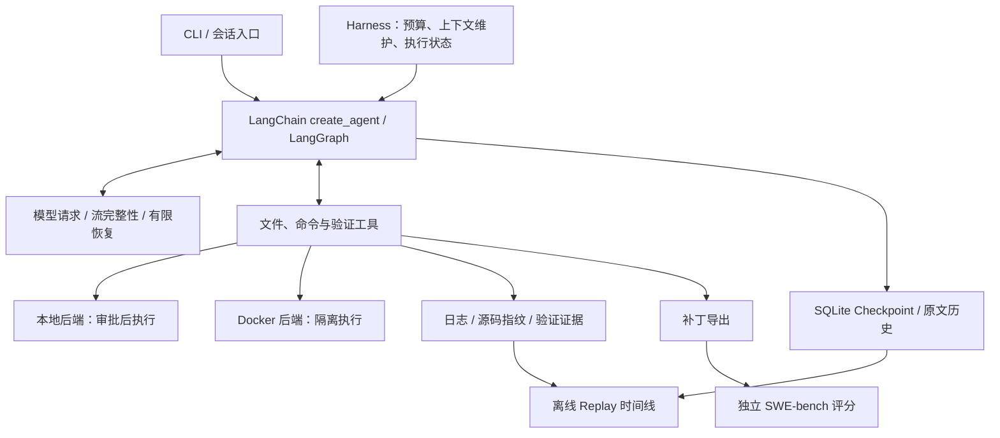

# CLI Rb

基于 LangChain / LangGraph 的自然语言 Coding Agent，支持 OpenAI-compatible Chat Completions 和 Responses 服务。模型负责调查、规划和修改；程序负责工具执行与审批、持久化、预算与验证证据核对。

项目关注 **Harness 如何维持工作质量**：约束执行边界、保留可追溯证据，并在中断和上下文增长时准确报告状态。需求解释与测试覆盖仍由模型选择，正常结束或局部测试通过都不等于任务解决。项目已有工程回归与小样本对照实验，没有当前统一版本的完整 SWE-bench 成绩，也没有长期工作质量不退化的证明。

**技术栈：** Python 3.12 · LangChain / LangGraph · SQLite · Docker · Responses API

## 架构与设计取舍



| 层次 | 实现与职责 | 边界 |
| --- | --- | --- |
| Agent Loop | `runtime/agent.py` 复用框架状态图与 middleware，模型选择调查、编辑和验证工具 | 不自行重写调度框架；不把回复返回视为任务成功 |
| 默认 assist Harness | `runtime/assistance.py` 提供 Environment Facts、预算/修改/证据状态和验证工具 | 旧 `full` 模式的强制计划与收尾核对不在默认模式同时启用 |
| 请求恢复 | `model_recovery.py`、`response_stream.py` 关闭 SDK 隐式重试，对指定瞬态错误有限重试，拒绝不完整流中的工具调用 | 重试当前模型请求，不重放旧工具；不承诺外部副作用 exactly-once |
| 执行与交付 | `workspace/` 提供本地审批、Docker 后端、工作区快照与补丁导出 | 本地审批不是操作系统沙箱；容器隔离需显式选择 |
| 证据管理 | `quality/` 记录命令、日志、测试摘要和前后源码指纹，区分当前与历史证据 | 被拒绝的命令保留审计记录，但不是执行证据；退出码为零不代表需求满足 |
| Checkpoint / 上下文 | `persistence.py`、`context.py`、`history.py` 保存恢复位置、摘要与可检索原文 | 不确定中断需检查后恢复；摘要有成本，不能保证语义无损 |
| Replay / 评测 | `evaluation/timeline.py` 重建消息、工具与证据；求解和官方评分分离 | Replay 不重新执行工具；评分信息不进入求解输入 |

## 验证结果与实验结论

以下结果测量不同对象，**不能合并为一个通过率，也不能作为当前 master 的统一成绩**。测试证据核对日期为 2026-10-21。

| 类型 | 版本与范围 | 已记录结果 | 可以得出的结论 |
| --- | --- | --- | --- |
| 工程回归 | 独立修复提交 `b58c509ccd65496876b6aa2fbd8a4cf3e1008f01`，Windows 11 build 26300 / Python 3.12.10 | **397 passed、14 skipped、0 failed**；Ruff、锁文件与依赖一致性检查通过 | 该提交的默认离线套件通过；14项 Docker 集成测试跳过，不能写作全部测试通过 |
| SWE-bench 历史累计 | 六批、150个不同任务，跨多个 Harness 版本 | **99 solved、49 failed、2 unknown**；累计确认解决率99/150（66.0%） | 描述历史运行规模；不是单一版本成绩，不证明优化收益 |
| Environment Facts A/B | 冻结 Luna v3；`gpt-6-luna` / `medium`；3道已曝光开发题，各组各题一次 | A/B均 **2/3 solved**；环境不匹配请求 **1/1**；共102次模型HTTP、1,647,862 tokens | 未达到“环境不匹配请求严格减少”的预设正向信号；不宣称质量或泛化提升 |
| Responses Smoke | 独立 Luna Smoke，真实流式请求和工具往返 | 2次HTTP、9,063 tokens，工具结果回传成功 | 验证该端点的基本链路；不代表长期负载、全部恢复路径或真实 encrypted reasoning 转发已验证 |

工程修复覆盖拒绝命令的证据语义、Responses 测试 transport 与正式客户端的一致性，以及过时断言；没有通过放宽安全校验获得通过结果。完整回归在提交前执行，八个修复文件哈希与提交内容核对一致。分组测试是全套的子集，不能重复累加。

### A/B 如何控制变量

- A为默认 assist + Environment Facts，B为assist仅关闭整个Environment Facts功能包；任务、源码、模型、推理强度、预算、每题Docker镜像和官方评分配置固定。
- 配对顺序为 Django A→B、sklearn B→A、SymPy A→B；六个cell各运行一次，不因质量失败追加尝试。Sol v2保留冻结记录，但没有运行正式Sol对照实验。
- 求解器只接收公开任务和固定版本仓库；参考补丁、隐藏测试与评分材料放在求解工作区之外。保留原始轨迹、补丁、用量、评分和异常，基础设施未知不伪装成解题失败或成功。
- A共806,319 tokens，B共841,543 tokens；这组观察不能从Token差异推出机制因果。三题已曝光、每cell一次且Replay审阅非盲，未估计统计显著性；不能写作“显著提升”或“已证明无效”。
- 客户端HTTP/Token准入额度是执行停止条件，不是账单硬上限；正式批次实际金额未验证。

后续离线验证覆盖研究也未提供足够的可靠触发证据，因此没有新增 Harness 机制。负面结果被保留，研究已经结束。

原始实验与审计材料在本地保存，不随仓库分发；此处是结果摘要，公开仓库不包含完整复现实验包。当前仍需明确区分Linux/通用Docker回归、便携包版本、长上下文质量及跨供应商行为的验证范围。

## Windows 双击试用

项目目录可以选择普通文件夹：程序会询问是否初始化为本地 Git 项目，仅在同意后创建 `.git`，不自动提交或上传文件。拒绝后可重新选择；选择仓库子目录时，会先确认是否改用根目录。需要本机已安装 Git for Windows。

已生成便携包时，双击项目根目录的 `Start CLI Rb.cmd` 即可启动；它优先使用本机 `.env.local`，未设置配置时使用已有 `.env.sub2api`。分发版位于 `dist/CLI-Rb-Windows`，内含 Python 与依赖，双击其中的 `Start CLI Rb.cmd`；首次选择本机模型配置文件，此后记住配置位置和上次项目目录。包内不含模型密钥。日常聊天默认使用本机开发环境，不需要 Docker；模型服务须可用。常规查看、测试和语法检查自动批准，重要或不明确的命令请求授权，本地命令并非沙箱。高级选项 `--no-local` 使用 Docker，`--isolated` 使用容器与项目副本；评测入口仍沿用隔离执行。

默认只显示当前工作状态，最终答复支持 Markdown、列表、表格与代码高亮。工具参数、返回内容和中间文字不刷屏；详细证据保存在会话中，授权操作仍显示具体内容。完整答复在生成结束后呈现，不逐字显示未完成草稿。

- Enter 发送，Shift+Enter 换行；底部显示上下文估算和本轮耗时。
- `/changes` 查看当前差异，`/details` 查看上次答复与测试情况，`/progress` 回看本轮执行过程。执行时展示最近阶段，最终答复出现后自动收起。
- `/status` 查看工作区与会话位置，`/help` 查看帮助，`/exit` 退出。

打包入口：在已按锁文件安装依赖的 Windows Python 3.12 环境运行 `python scripts/build_portable.py dist/CLI-Rb-Windows`。目标必须是新目录；只复制解释器、依赖和应用源码，不复制仓库配置、会话或历史实验。便携包仍需在目标电脑检查 Git、本地开发工具与模型服务，不代表已完成陌生电脑验收。

## 快速开始

需要 Python 3.12、uv 和 Git；本地聊天复用本机开发工具。容器模式和隔离评测另需 Docker Linux 引擎及相应镜像。

```powershell
uv sync --locked
uv run cli-rb demo
Copy-Item .env.example .env.local
```

编辑`.env.local`，填写模型ID、服务地址及必要的密钥，然后启动：

```powershell
$env:CLI_RB_ENV_FILE = '.env.local'
uv run cli-rb doctor
uv run cli-rb
```

只加载显式指定的配置文件，进程环境变量优先。真实配置与密钥由Git忽略，不写入会话模型配置。远程服务要求HTTPS和`CLI_RB_ALLOW_REMOTE=1`；不会自动回退其他服务。

默认辅助模式：`uv run cli-rb` 或 `uv run cli-rb chat`；旧模式可显式使用 `uv run cli-rb chat --harness full`。任务开始时只读探测命令能力并区分 Agent 工具与 shell 命令，未知项明确保留；该说明不授予权限。模型自行决定调查和修复路线；程序自动提供预算估算、修改文件和测试证据时效，并通过 `get_task_state` 查询详情。`run_verification` 自动记录证据，无需手动登记行为或绑定测试；权限、上下文维护和硬预算仍生效。状态中的“回复已返回”和“测试通过”不代表需求已经全部满足。Docker 会话恢复沿用原模式；已有便携包需重新构建才包含此入口。

| 配置 | 含义 / 默认值 |
| --- | --- |
| `CLI_RB_BASE_URL` | 服务根地址，默认`http://localhost:1234/v1` |
| `CLI_RB_MODEL` | 必填的服务端模型ID |
| `CLI_RB_API_KEY` | 服务要求的密钥 |
| `CLI_RB_USE_RESPONSES_API` | `1`启用Responses，默认`0` |
| `CLI_RB_REASONING_EFFORT` | 服务支持时设置，例如`medium` |
| `CLI_RB_CONTEXT_WINDOW` | 本地工作窗口，默认`200000`；需匹配模型能力 |
| `CLI_RB_CONTEXT_STRATEGY` | 默认`summary`；`codex_v2`为需单独验证服务兼容性的实验选项 |
| `CLI_RB_MAX_OUTPUT_TOKENS` | 默认`32768`，同时用于上下文预留 |
| `CLI_RB_REQUEST_TIMEOUT_SECONDS` | 请求等待和流式静默超时，默认`120`秒 |

Responses模式使用`store=false`，保留工具往返需要的加密推理内容，发送当前工作历史，不依赖服务端`previous_response_id`。上下文使用启发式估算，另留输出预算和计数余量。服务商可能不执行客户端输出限制，调用次数与任务时限仍由Harness管理。

`CLI_RB_CONTEXT_STRATEGY`默认为`summary`，由Harness维护可读的工作交接摘要，包含目标、决策、实际动作与证据、未完成项、下一步及历史消息引用。摘要正文最多约2048估算tokens；整理后目标为可用输入预算的20%，统一计算系统提示、工具、用户要求、摘要和近期历史。必须保留的用户要求或最新工具配对较大时，目标会明确上调，仍不得超过输入上限。压缩占用一次已有模型调用，失败保留原历史，没有固定15%的压缩承诺。

会话模式提供`read_history`：按关键词搜索已归档的可见消息，再按消息ID分页读取原文。归档在自有摘要压缩前写入会话内的`context-history.sqlite`，不包含尚未归档的当前消息，也不会自动导入旧会话的全部检查点；摘要、旧工具记录都不是新的授权或当前验证证据。原生`codex_v2`作为实验选项保留，使用Responses流中的`compaction_trigger`。它依赖服务商对该协议的支持和框架内部请求转换，不保证兼容所有Responses服务；需单独验证后显式选用，不是自有摘要失败时的自动回退。

`doctor`只检查环境；`demo`使用脚本模型和内存文件，不调用真实服务。`smoke`会请求真实模型验证工具往返，可能产生费用；它不代表编码任务验收。

## 使用与执行边界

启动时选择模型、Git仓库并确认工作区。Enter发送，Shift+Enter换行（Windows；其他终端可用Ctrl+J换行），Ctrl+D / Ctrl+C退出。直接输入“解释入口”“修复问题并验证”等要求。

- 默认直接修改所选仓库，普通文件编辑立即生效。需要副本时使用`uv run cli-rb --isolated`。
- 工具支持浅目录、路径匹配、分页搜索、读取、精确编辑与差异查看。本地模式使用本机工具；显式选择容器模式后，缺少 Docker 或镜像会报错，不自动回退本机。
- 本地模式的常规开发操作按规则或独立模型审查批准，推送、重大删除和系统修改需人工确认。命令拥有当前账户权限，审批不构成操作系统隔离，也不证明程序理解了全部命令语义。
- 每条任务默认最多50次模型调用、100次工具调用、30分钟。使用`uv run cli-rb --help`查看入口选项；收尾反馈共享原预算。
- 聊天中展示简短阶段进展，最终正文由模型依据证据返回；工具参数与结果保存在日志，授权时可查看具体命令。不展示隐藏推理；程序状态不代替需求验收。

## 状态、验证与收尾

默认辅助模式由模型决定调查路线、修改方案、验证范围与收尾时机。程序提供工具与权限边界、任务阶段、预算估算、修改清单和验证证据；模型可用 `get_task_state` 分页查询详情。上下文余量是估算，未知数据明确保留。

`run_verification`自动记录命令、执行结果、日志及前后代码指纹，识别pytest、unittest和Sympy原生摘要。修改后旧版本验证显示为历史证据；通过只证明相应检查，不证明全部需求满足。无需登记行为或手动绑定测试，不启用强制计划与收尾反馈中间件。

编辑反馈仍提供Python语法与测试定义变化提示。长输出保留首尾，完整日志可分页读取。工具遵守原权限、上下文和硬预算；辅助状态本身不授予权限。

模型收尾应说明实际改动、验证结果、已知失败及未验证要求。程序记录回复已返回，不推断任务语义成功。指纹覆盖筛选后的工作区，不覆盖依赖与外部资源，也不能证明测试充分。

明确的实现任务可由程序调用者显式设置 `build_agent(..., implementation_task=True)`：辅助模式在尚无文件修改就收尾时，最多提醒一次尝试有效候选或提供具体阻塞证据。提醒共享原预算，保留最后一次无工具收尾，不要求伪造修改或成功。该选项默认关闭，不自动将解释、审阅等请求判作实现任务；普通聊天入口不启用它。

旧 `full` 模式保留用于历史会话和对照，提供计划、行为登记、证据绑定及有界收尾核对。新会话默认 `assist`；恢复沿用保存模式，未记录模式的旧会话按 `full` 处理，不在恢复中切换。旧便携包需重新构建才包含新默认值。

## 会话与恢复

模型请求遇到 HTTP 408、429、500、502、503、504，或明确的 `No generations found in stream.` 空响应时最多重试两次，分别等待 1 秒和 2 秒。Responses 流必须收到完成事件后才返回可执行工具调用；缺少完成事件时拒绝部分响应，并在原额度内有限重试。重试只重发当前模型请求，不重放已执行工具；失败尝试也占用原有模型调用额度，等待计入任务时限。关闭 SDK 隐式重试，每次请求仍经过用量回调；会话中的 `model-attempts.jsonl` 保留逐次结果，未报告用量记为未知。持续故障、其他解析或 HTTP 错误、连接超时或无法确认完整性的其他流中断仍停止；摘要保留自身已有的有界策略。外部累计预算另有未知用量停止或保守扣减规则，见下文。

源码入口会话默认保存在`.cli-rb/sessions/<ID>/`，便携启动器保存在`%LOCALAPPDATA%/CLI Rb/.cli-rb/sessions/<ID>/`，包括SQLite检查点、基线、筛选清单、工具日志、验证记录和收尾审阅。长对话会整理工作上下文，保留用户要求和工具配对；原始记录不会因摘要删除。摘要长度采用软目标，按整个请求的缩减和余量决定是否采用；无效或过大的摘要在原维护额度内最多尝试两次，摘要请求也计入模型调用上限。接近模型窗口上限的工作质量尚需验证。

```powershell
uv run cli-rb --resume '.cli-rb/sessions/<ID>'
uv run cli-rb inspect-session '.cli-rb/sessions/<ID>' --changes
uv run cli-rb explain-session '.cli-rb/sessions/<ID>' --request '原任务要求'
```

当前 `--resume` 仅支持容器会话；本地旧会话恢复尚未开放，文件和记录仍保留。容器会话恢复沿用原工作区和基线，不重放旧工具。中断后核对不确定动作与差异，由用户确认继续，后续写入重新授权。拒绝会保留现场；基线损坏、检查点异常或遗留容器未处理时阻止恢复。

`inspect-session`读取本地证据；`explain-session`单独调用模型解释记录，不推进旧任务，也不能作为完成证明。Ctrl+C保留已发生修改，不自动撤销；客户端取消不证明服务端计算立即停止。

## 开发与评测

```powershell
uv run ruff check src tests
uv run pytest -q
# Docker引擎可用且基础镜像已准备时：
$env:CLI_RB_DOCKER_TESTS = '1'
uv run pytest tests/test_docker_integration.py -q
```

按改动范围执行必要检查；测试数量不是编码任务解决率。不在例行整理中自动重跑模型或SWE评测。

评测模块保留通用入口，历史轮次脚本和实验数据不属于产品发布：

| 模块（`python -m ... --help`） | 职责 |
| --- | --- |
| `cli_rb.evaluation.tasks` | 从JSONL导出公开任务字段，或将补丁封装为预测 |
| `cli_rb.evaluation.runner` | 在干净指定版本与已准备镜像上运行Agent，保存轨迹和补丁 |
| `cli_rb.evaluation.environment` | 显式构建旧项目所需的兼容环境变体 |
| `cli_rb.evaluation.execution` | 分离安装与测试阶段的超时；提供内部网络的本地httpbin依赖 |
| `cli_rb.evaluation.scoring` | 在单独安装`swebench==3.0.17`的环境生成脚本与评分 |

原始数据、参考补丁和评分测试名单必须放在求解工作区之外。Agent只获得公开issue和固定版本仓库。评分与求解分离，使用指定目标及回归测试；节点解析缺失标为`evaluation_error`，不等同于模型失败。环境适配成绩需单列，日志解析和网络/fixture问题仍需审阅。`status=ended`仅代表执行结束。

## 源码结构

评测的大仓库容量通过run_task的max_total_bytes显式配置，并由快照清单统一传给补丁和验证账本；默认64 MiB。评分器保留原日志，清理颜色与进度装饰；指定测试完整且官方判定通过时，捕获日志中的DNS文字仅作诊断，不推翻通过。其余网络故障或节点缺失仍保留为未知。新的评分编排应调用run_scoring_script，默认安装1800秒、测试300秒、构建并发2，安装失败不进入测试。Requests可通过local_httpbin返回的内部网络和HTTPBIN_URL连接固定镜像服务，需记录为环境变体，求解仍离线。旧实验脚本和成绩不自动迁移。

分批评测编排可调用 `cli_rb.evaluation.batch.run_batch`：传入固定题序、需要校验的源码/配置/协议文件，以及求解和评分回调，默认每次处理25题。所有批次复用同一个运行目录；已保存结果不会重新求解，评分异常单独落盘，连续3次评分错误暂停。进程被中断时保留正在执行的状态；不自动重放不确定的求解，已保存补丁可通过显式 `rescore` 写入新的评分尝试。文件冻结检查和进程锁阻止版本漂移或重复派发；回调仍负责每题模型预算、容器清理、补丁完整性和错误分类。此接口不自动启动500题，也不把已有冻结实验脚本改写为可恢复批次。

编译项目可先用 `build_scoring_environment` 在官方镜像摘要之上准备固定版本的构建工具，保存新镜像ID和安装包清单；它不覆盖官方镜像，也不自行决定依赖版本。正式求解前必须验证所选环境能够执行官方安装及评分流程，网络、构建工具等适配需写入环境清单，不能当作原始环境成绩。

Coding模式在原模型请求预算内保留最后一次调用用于无工具收尾，报告已有证据和未完成项，不增加额度。这不保证任务成功，也不绕过服务错误、上下文或时间限制。

Responses流会保留服务端完成记录中的工具参数：网关省略参数delta时，仅补齐完成记录里已有的后缀；正常流不重复拼接，参数矛盾会停止。同步和异步模型调用共用此适配。上下文成功压缩并降至重新维护阈值后，可以处理下一次增长；同一次持续高压下的失败摘要仍限制尝试次数。

需要跨续跑累计预算的评测可使用`runtime.request_budget.PersistentRequestBudget`，固定时间、HTTP请求数和tokens上限，并通过`attach(model)`计量顺序执行的异步LangChain调用及其摘要模型副本。预算恢复不重置；请求发出前持久记录进行中状态，错误、中断或缺失usage后默认阻止新请求。已记录tokens是已知小计，不是未知请求消耗为零。显式配置`incomplete_token_bound`时，缺完成事件的Responses流在工具执行前抛错，可在模型层有限重试；每个失败请求按调用方提供的输入加输出上界扣减，`bounded_unknown_tokens/requests`单独保留，不能将扣减额度报告为实际消耗。其他错误、进程中断或缺usage仍停止。独立审批模型需单独接线；直接SDK调用的usage需由调用方归集，否则请求保持用量未知。该组件不会为交互模式添加默认token上限。

```text
src/cli_rb/
  runtime/      Agent循环、上下文、计划、持久化、提示加载
  workspace/    文件工具、本地执行与审批、Docker、快照、补丁
  quality/      验证账本、风险审阅、收尾核对
  evaluation/   任务、环境、执行、评分
  interface/    CLI、授权、诊断、会话解释、演示
  prompts/      模型工作规范
  config.py     模型服务配置
tests/          工程回归与Docker集成检查
```

CLI入口为`cli_rb.interface.cli:app`。从旧版本升级后运行`uv sync --locked`刷新启动器；旧内部模块路径已移除。配置模板`.env.example`不含凭据，本地会话、实验数据与协作文档不进入发布包。

本地审批不依赖 Codex：常规开发操作按规则通过，复杂命令由独立模型审查，推送、重大删除和系统修改仍需人工确认。命令直接以当前账户权限运行，不是操作系统沙箱。独立审查沿用当前模型服务，每会话最多 20 次，每次最多 2048 输出 tokens / 30 秒，用量另存 approval-reviews.jsonl；审批异常转人工。
